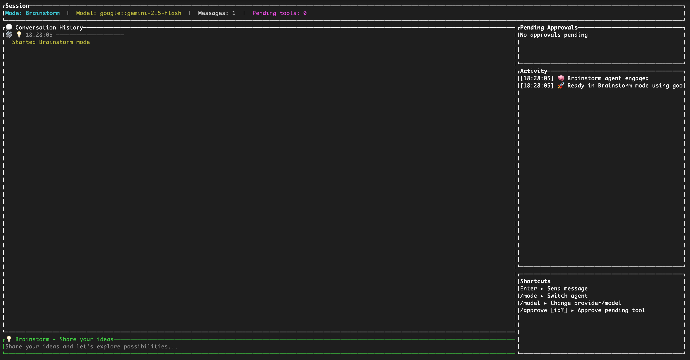

# Bindr

[](https://crates.io/crates/bindr)
[](https://docs.bindrcli.com)
[](https://github.com/OneDevArmy/bindr/actions)
[](./LICENSE)
[](https://tokio.rs)

<p align="center">
  
</p>

Bindr is a terminal-native orchestration engine for AI-assisted software creation. It coordinates specialized agents in Brainstorm → Plan → Execute → Document modes, streaming their collaboration through a responsive TUI while keeping humans in control of tools, context, and approvals.

## Overview
- **Agent-aware kernel**: Each mode runs inside an isolated Tokio task with supervised restarts, telemetry, and a broadcast event bus for downstream consumers.
- **Stateful sessions**: Conversation history, model selections, and project metadata persist via `SessionManager`, enabling smooth handoffs and resumable work.
- **Guardrails-first tooling**: Capability profiles and approval gates keep risky operations visible and auditable before execution.
- **Built for operators**: Structured logging, live status panes, and environment warnings surface issues before they impact your workflow.

## Installation
Bindr ships as a cargo crate. Install the CLI with:

```bash
cargo install bindr
```

The repository includes a `rust-toolchain.toml` that pins Rust `1.88.0` with `clippy` and `rustfmt` so local development matches CI.

## Running Bindr
Launch the TUI from the root of a project you want to work on:

```bash
bindr
```

Inside the conversation pane you can explore `/mode`, `/model`, `/tools`, and `/help` to steer the agents. When a tool requires credentials (for example, web search), export the relevant API key as an environment variable before starting Bindr. The UI guides you through missing configuration at launch time.

## How It Works
The kernel (`src/core/kernel.rs`) acts as the control plane. Mode-specific agents connect through `AgentRuntime`, exchange messages through bounded channels, and emit structured tool calls. The UI (`src/ui/`) renders streaming responses, actions awaiting approval, and system telemetry. Tool execution is sandboxed in `src/tools/`, with results streamed back into the session so context stays current.

## Development Workflow
- Review `CONTRIBUTING.md` for environment setup, testing expectations, and submission guidelines.
- Use `cargo fmt`, `cargo clippy -- -D warnings`, `cargo check`, and `cargo nextest run` before opening a pull request.
- Document architectural changes in `docs/architecture.md` and keep `AGENTS.md` aligned with runtime responsibilities.

## Support & Community
- File issues or feature requests on GitHub.
- Join discussions to propose larger architectural work before you start coding.
- For security disclosures, email [security@bindrcli.com](mailto:security@bindrcli.com).

## License
Bindr is licensed under [Apache-2.0](./LICENSE).
